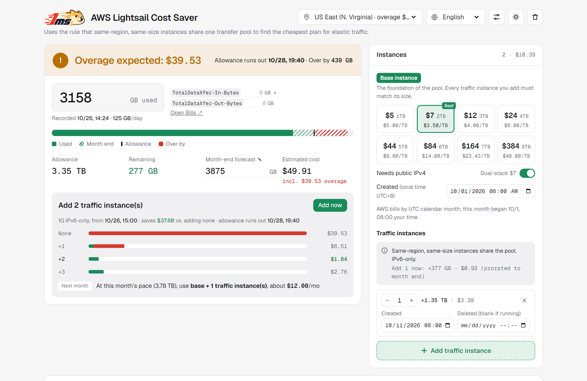

# AWS Lightsail Cost Saver

**English** · [简体中文](README.zh-CN.md)

> **Live demo: [ls.1ms.dog](https://ls.1ms.dog/)**. Open it and go, no sign-up.

<a href="https://ls.1ms.dog/"><picture>
  <source media="(prefers-color-scheme: dark)" srcset="docs/preview-en-dark.png">
  
</picture></a>

If you run anything traffic-heavy on Lightsail, you've probably had one scary bill. Once a plan's included transfer runs out, overage costs $0.09/GB, about $92 per TB. Yet a $5 IPv6 instance comes with 2 TB of transfer, which works out to $2.50 per TB. Same terabyte, more than 30× the price.

What many people miss: **Lightsail instances of the same size in the same region share one transfer pool**. In a busy month you can add a few small instances and the pool grows with them; when traffic drops, delete them. Billing is hourly, so nothing is wasted.

The hard part is doing the math. Will you go over this month? By how much? How many instances should you add, and when? How is a mid-month instance's allowance prorated? Can overage you've already hit be undone? The answers are scattered across AWS docs and forum threads, and it's easy to get them wrong by hand.

This tool does that math for you. Enter what you've used so far this month, or just your expected monthly total, and it tells you:

- **Whether this month is safe**: safe, overage expected, or already over, and how much extra you'd pay
- **When the allowance runs out**, so you know how long you have to act
- **The cheapest number of traffic instances to add**, added to your setup with one click
- **What to run next month** at the current pace

No sign-up. Open it and go; your data stays in your own browser. Available in 10 languages, with light and dark themes, and it works on phones.

## Features

| Area | What it does |
|---|---|
| Status banner | One glance: **Safe**, **Overage expected** or **Over allowance**, with the dollar amount and when the allowance runs out |
| Usage input | Type this month's total, or fill in the two bill items `TotalDataXfer-In-Bytes` and `TotalDataXfer-Out-Bytes` and they're added up |
| Forecast bar | Usage so far, the projected rest of the month, the allowance line and anything past it |
| Scale-up plan | Compares adding 0, 1, 2… traffic instances (instance cost + overage) and adds the cheapest with one click |
| Base instance | Pick a plan by monthly price; each card shows transfer and cost per TB, with the cheapest marked |
| Traffic instances | Always the same size as the base and IPv6-only (cheapest, and pooled with a dual-stack base); start and delete times per batch |
| Next month | Suggests base + N instances for next month at the current pace |
| Checks | Warns when a forecast is below usage or a deletion time is before creation; imported backups are sanitized |

### Two calculation modes

| Mode | When | How it works |
|---|---|---|
| Actual usage | You entered usage | Daily pace is measured from the first instance's start; overage already incurred can't be offset; new instances are prorated from the next full hour |
| Full-month plan | Only a month-end forecast | Nothing before today counts as used; every running instance counts for the whole month, so the answer is "how many for the full month" |

## Billing rules used

| Item | Rule |
|---|---|
| What counts | Inbound **and** outbound traffic both use the allowance |
| What's charged | Only outbound traffic beyond the allowance (the "outbound share" setting, default 100%) |
| Pooling | Same region **and** same bundle size; dual-stack and IPv6-only of one size pool together |
| Mid-month changes | Billed hourly; allowance prorated by lifetime (not stated in the docs; an AWS Support–reviewed re:Post answer says hourly; can be switched off) |
| Overage already incurred | Can't be offset by adding instances later |
| Units | 1 TB = 1024 GB (the Lightsail API's `transferPerMonthInGb` is 1024 for a 1 TB plan); billing month = UTC calendar month |
| Half allowance | Mumbai, Sydney, Jakarta, Malaysia, Hong Kong, São Paulo |

Estimates only; your AWS bill is final. This is not an official AWS tool.

## Deploy

The whole app is `public/`. Any static host works; three ready-made options follow.

### Cloudflare (recommended)

Requests for static assets are free and unmetered, and there's no commercial-use restriction. `wrangler.toml` is set up as a Worker that only serves static assets from `public/` (no Worker script), which is the default flow in the Cloudflare dashboard today.

**Option A: connect this repository (Workers)**

1. Fork this repository.
2. Cloudflare dashboard → **Workers & Pages** → **Create** → **Import a repository**, then pick your fork.
3. Settings:
   - Build command: *(leave empty)*
   - Deploy command: **`npx wrangler deploy`** (the default)
   - Preview command: `npx wrangler versions upload` or the default; preview builds are optional
4. **Deploy**. Every push to the main branch redeploys.

**Option B: Cloudflare Pages**

Workers & Pages → **Create** → **Pages** → **Connect to Git** → Framework preset **None**, Build command *(empty)*, Build output directory **`public`**.

**Option C: deploy from your machine**

```bash
npx wrangler deploy
```

### Vercel

**Option A:** Vercel dashboard → **Add New** → **Project** → import your fork. No framework, no build command; `vercel.json` already sets the output directory to `public`.

**Option B:**

```bash
npx vercel --prod
```

Note: the free Hobby plan is for **non-commercial use only** and stops serving once its monthly request quota is used up.

### Docker

A ready-to-run image is published to Docker Hub as `imxjp/lightsail-cost-saver` (nginx serving the static page, about 20 MB, `linux/amd64` and `linux/arm64`).

```bash
docker run -d --name lightsail-cost-saver -p 8080:80 --restart unless-stopped imxjp/lightsail-cost-saver:latest
```

Then open http://localhost:8080.

With Docker Compose:

```yaml
services:
  lightsail-cost-saver:
    image: imxjp/lightsail-cost-saver:latest
    ports:
      - "8080:80"
    restart: unless-stopped
```

To build it yourself instead, clone the repository and run `docker compose up -d --build`.

## Before you deploy (optional)

```bash
# Refresh prices from the AWS Price List API into public/index.html (Node 18+)
node scripts/update-prices.mjs

# Set your public URL for SEO: canonical, hreflang, sitemap.xml, robots.txt
node scripts/set-site-url.mjs https://your-domain.example
```

Both run once on your machine or in CI and add nothing to page load. If a region fails to download, its previous prices are kept.

## Project layout

```
public/index.html                 the whole app (logos inlined, no external images)
scripts/update-prices.mjs         refresh prices from the AWS Price List API
scripts/set-site-url.mjs          canonical / hreflang / sitemap / robots for your domain
assets/                           1ms logo masters (light and dark), kept for reference
docs/                             README preview screenshots
Dockerfile, nginx.conf            container image
.github/workflows/docker.yml      builds and pushes the Docker Hub image
.github/workflows/pages.yml       optional GitHub Pages deployment
wrangler.toml, vercel.json, netlify.toml
```

## Official references

- [Lightsail pricing](https://aws.amazon.com/lightsail/pricing/)
- [Data transfer FAQ](https://docs.aws.amazon.com/lightsail/latest/userguide/amazon-lightsail-faq-data-transfer-allowance.html)
- [Billing FAQ](https://docs.aws.amazon.com/lightsail/latest/userguide/amazon-lightsail-frequently-asked-questions-faq-billing-and-account-management.html)
- [AWS Service Terms](https://aws.amazon.com/service-terms/)
