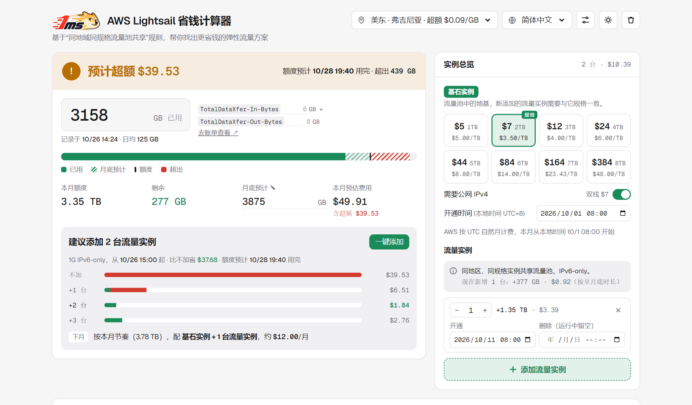

# AWS Lightsail 省钱计算器

[English](README.md) · **简体中文**

> **在线体验：[ls.1ms.dog](https://ls.1ms.dog/)**，打开即用，无需注册。也可以[交给你的 AI Agent](#搭配你的-ai-agent-使用)。

<a href="https://ls.1ms.dog/"><picture>
  <source media="(prefers-color-scheme: dark)" srcset="docs/preview-zh-dark.png">
  
</picture></a>

用 Lightsail 跑流量型业务的人，大概都被月底账单吓过一次。套餐自带的流量用完之后，超出的部分按 $0.09/GB 收费，折合下来每 TB 要 $92；可一台 $5 的 IPv6 实例本身就带 2 TB 流量，相当于每 TB 只要 $2.5。同样是 1 TB 流量，价格差了三十多倍。

很多人不知道，Lightsail 里**同地区、同规格的实例共享同一个流量池**。流量大的月份临时加几台小实例，池子就跟着变大；流量回落了再删掉，按小时计费，一分钱都不浪费。

麻烦在于算清楚这笔账：这个月到底会不会超？会超多少？现在加几台最划算？月中才加的实例，额度怎么折算？已经超出去的部分还能不能补救？这些规则散落在 AWS 文档和社区问答里，自己掰着手指算很容易出错。

这个工具就是帮你把这笔账算明白的。填上本月已用流量，或者只填一个预计的月总量，它会直接告诉你：

- **这个月安不安全**：安全、预计超额，还是已经超额，会多付多少钱
- **额度哪天用完**，还剩几天可以补救
- **加几台流量实例最省钱**，点一下就加进你的配置
- **下个月该怎么配**，按这个月的节奏给出建议

不用注册，打开就能用，数据只存在你自己的浏览器里。支持 10 种语言（每种语言都是单独预渲染的页面，例如 [/zh/](https://ls.1ms.dog/zh/)、[/ja/](https://ls.1ms.dog/ja/)）和浅色、深色主题，手机上也好用。

## 功能说明

| 模块 | 作用 |
|---|---|
| 状态栏 | 一眼看出**安全**、**预计超额**还是**已超额**，并直接给出超额金额和额度用完的时间 |
| 用量输入 | 直接填本月总用量，或分别填账单项 `TotalDataXfer-In-Bytes`、`TotalDataXfer-Out-Bytes`，自动加总 |
| 预测进度条 | 已用、预计到月底的部分、额度线，以及超出额度的部分 |
| 扩容方案 | 对比加 0、1、2… 台流量实例的总花费（实例费 + 超额费），最省的方案可一键添加 |
| 基石实例 | 按月费选择套餐，每张卡片标出流量和每 TB 成本，并标记最省的一档 |
| 流量实例 | 固定与基石同规格、使用 IPv6-only（同规格最便宜，且与双栈基石合并额度），每批可设开通和删除时间 |
| 下月建议 | 按本月节奏，给出下月「基石 + N 台流量实例」的配置 |
| 输入校验 | 月底预计低于已用流量、删除时间早于开通时间都会提示；导入的备份会逐项清洗 |

### 两种计算模式

| 模式 | 何时 | 怎么算 |
|---|---|---|
| 按实际用量 | 填了已用流量 | 日均从本月最早一台实例开通算起；已产生的超额不能被新实例抵消；新实例从下一个整点起按剩余时长折算 |
| 整月规划 | 只填了月底预计 | 不把今天之前当作已发生；所有运行中的实例按整月计算，给出整月不超额所需台数 |

## 搭配你的 AI Agent 使用

不想自己填？把它交给 ChatGPT、Claude、Gemini、Cursor 这类能联网的 Agent。Agent 读一份说明文档就会算，并给你一个预填好的链接，打开就能在页面上核对。页面右上角的 **接入 Agent** 里有同样的内容，可以一键复制。

### 一分钟上手

把下面这段发给 Agent，填上空白处：

```text
请先阅读 https://ls.1ms.dog/llms.txt，按其中的 Lightsail 计费规则帮我计算流量池。
我的情况：区域 ___，套餐 ___（如 $7 / 2 TB 流量），本月已用 ___ GB（截至 ___）。
请告诉我这个月会不会超额、加几台流量实例最省钱，并给我一个预填好的计算器链接方便核对。
```

链接打开后会载入这套配置；你原来的数据会先备份，可以一键恢复。反过来，在页面的 **设置 → 复制配置链接** 可以把当前配置变成链接发给 Agent。

### 典型用例

| 用例 | 可以这样问 | 需要的权限 |
|---|---|---|
| 会不会超 | 我在东京用 $12 / 3 TB 的套餐，本月已用 2800 GB，这个月会超吗？要加几台流量实例？ | 无 |
| 部署选型 | 每月大约 8 TB 流量，用户主要在东南亚，Lightsail 怎么配最便宜？ | 无 |
| 下月规划 | 下个月预计在法兰克福跑 12000 GB，用 $7 / 2 TB 的套餐，开几台流量实例成本最低？ | 无 |
| 账单解读 | 这是我账单里 Lightsail 的流量明细（粘贴），还剩多少额度？会被收费吗？ | 无 |
| 流量预警 | 每天早上读取我实例的网络流量指标，预计超额就提醒我。 | AWS 只读 |
| 自动扩容 | 预计超额时，在同一区域按推荐数量创建同套餐的 IPv6 实例，创建前先让我确认。 | AWS 写权限，会产生费用 |

在问题后面加一句「规则和算法见 https://ls.1ms.dog/llms.txt」，Agent 就会按同一套口径计算。

### 开发者接入

全部是静态文件，允许任何网站跨域读取，没有服务端 API，也不需要密钥。

| 文件 | 内容 |
|---|---|
| [llms.txt](https://ls.1ms.dog/llms.txt) | 给 Agent 读的说明：计费规则、链接参数、返回字段 |
| [prices.json](https://ls.1ms.dog/prices.json) | 各区域的套餐价格、流量额度和超额单价 |
| [calc.js](https://ls.1ms.dog/calc.js) | 计算模块（ES Module），就是网页实际运行的那份代码，结果和页面一致 |

```js
import { calculate, buildLink } from "https://ls.1ms.dog/calc.js";
const prices = await (await fetch("https://ls.1ms.dog/prices.json")).json();

const input = {
  region: "us-east-1", sizeGB: 1, usedGB: 3150,
  trafficInstances: [{ count: 1, start: "2026-10-11T00:00Z" }]
};
const result = calculate(input, prices);
const link = buildLink(input);   // 同一套配置的预填链接
```

`calculate` 返回的主要字段：

| 字段 | 含义 |
|---|---|
| `status` | `safe`、`overage-expected`、`over-allowance` 或 `needs-input` |
| `allowanceGB`、`usedGB`、`forecastGB` | 额度、已用、月底预计（GB） |
| `overageGB`、`overageCost`、`totalCost` | 预计超额量（GB）、超额费、总费用（USD） |
| `allowanceRunsOutAt` | 额度预计用完的时间（UTC） |
| `recommendation` | 建议加几台流量实例、从何时开始、能省多少 |
| `nextMonth` | 下月建议的流量实例数和月成本 |

预填链接的常用参数：

| 参数 | 含义 | 示例 |
|---|---|---|
| `region` | AWS 区域代码 | `us-east-1` |
| `size` | 套餐，以内存 GB 标识（prices.json 里可对应到价格和流量） | `1` |
| `used` | 本月已用 GB（入站 + 出站） | `3150` |
| `forecast` | 预计月底总量 GB；不填 `used` 时按整月规划 | `10000` |
| `nodes` | 流量实例，`数量@开始[~结束]`，UTC | `1@2026-10-11T00:00Z` |

完整参数见 [llms.txt](https://ls.1ms.dog/llms.txt)。Node.js 不能直接从网址导入，可以下载 `calc.js`，或直接用仓库里的 `public/calc.js`。`calc.js` 和 `prices.json` 由 `node scripts/build.mjs` 从 `public/index.html` 生成；`npm test` 会检查它们是否同步，并运行回归测试。

### 安全提示

- 配置链接里带有你的用量数字，分享前留意。
- 「流量预警」只需要只读权限，建议单独建一个只读的 IAM 用户或角色给 Agent。
- 「自动扩容」会创建真实计费的实例：只授予必要的权限，要求 Agent 创建前先确认，并设好实例数上限。
- 结果是估算，以 AWS 账单为准。

## 计算口径

| 项目 | 规则 |
|---|---|
| 额度扣减 | 入站**和**出站都扣额度 |
| 超额收费 | 只收超出额度的出站流量（「出站占比」设置，默认 100%） |
| 叠加 | 同地区**且**同规格才合并；同规格双栈与 IPv6-only 可合并 |
| 月中开通 / 删除 | 按小时计费；额度按存在时长折算（官方文档未写明；AWS re:Post 上经 AWS Support 审核的回答为按小时累计，可在设置中关闭） |
| 已产生的超额 | 之后新增实例无法抵消 |
| 单位 | 1 TB = 1024 GB（Lightsail API 中 1 TB 套餐的 `transferPerMonthInGb` 为 1024）；计费月为 UTC 自然月 |
| 额度减半地区 | 孟买、悉尼、雅加达、马来西亚、香港、圣保罗 |

结果仅为估算，以 AWS 账单为准。本工具不是 AWS 官方工具。

## 部署

整个程序就是 `public/` 文件夹，任何静态托管都能用。下面是三种现成方式。

### Cloudflare（推荐）

静态资源请求免费、不计量，也没有商用限制。`wrangler.toml` 已配置为一个只托管 `public/` 静态资源的 Worker（没有 Worker 脚本），对应 Cloudflare 控制台目前默认的创建流程。

**方式 A：连接本仓库（Workers）**

1. Fork 本仓库。
2. Cloudflare 控制台 → **Workers & Pages** → **创建** → **导入存储库**，选择你的 Fork。
3. 设置：
   - 构建命令：*（留空）*
   - 部署命令：**`npx wrangler deploy`**（默认值即可）
   - 预览命令：保持默认；「启用预览构建」可开可关
4. 点 **部署**。之后每次推送到主分支都会自动重新部署。

**方式 B：Cloudflare Pages**

Workers & Pages → **创建** → **Pages** → **连接到 Git** → 框架预设选 **无**，构建命令留空，构建输出目录填 **`public`**。

**方式 C：在本机部署**

```bash
npx wrangler deploy
```

### Vercel

**方式 A：** Vercel 控制台 → **Add New** → **Project** → 导入你的 Fork。不需要选框架，也不需要构建命令，`vercel.json` 已把输出目录设为 `public`。

**方式 B：**

```bash
npx vercel --prod
```

注意：免费的 Hobby 版**仅限非商业用途**，每月请求额度用完后会停止服务。

### Docker

镜像已发布到 Docker Hub：`imxjp/lightsail-cost-saver`（nginx 托管静态页面，约 20 MB，支持 `linux/amd64` 和 `linux/arm64`）。

```bash
docker run -d --name lightsail-cost-saver -p 8080:80 --restart unless-stopped imxjp/lightsail-cost-saver:latest
```

然后打开 http://localhost:8080。

使用 Docker Compose：

```yaml
services:
  lightsail-cost-saver:
    image: imxjp/lightsail-cost-saver:latest
    ports:
      - "8080:80"
    restart: unless-stopped
```

如果想自己构建，克隆仓库后运行 `docker compose up -d --build` 即可。

## 部署前（可选）

```bash
# 从 AWS Price List API 拉取最新价格，写回 public/index.html（需要 Node 18+）
node scripts/update-prices.mjs

# 设置正式域名：写入 canonical / hreflang，生成 sitemap.xml 和 robots.txt
node scripts/set-site-url.mjs https://your-domain.example
```

两条命令都只在本地或 CI 里跑一次，不影响页面加载速度。某个地区价格下载失败时，会保留该地区原来的价格。

只需要修改 `public/index.html`（英文页）。改完运行 `npm run build`，会重新生成 `calc.js`、`prices.json` 和其他语言的页面；各语言的文字直接写进 HTML，百度这类不执行 JavaScript 的搜索引擎也能收录。`npm test`（CI 也会跑）会在任何生成文件过期时报错。

## 项目结构

```
public/index.html                 整个程序，也是英文页（标志已内嵌，无外部图片）
public/zh/、ja/ … index.html      自动生成：每种语言一个预渲染页面
public/calc.js, prices.json      为 Agent 生成的计算模块和价格数据
public/llms.txt                   给 Agent 看的使用说明
scripts/build.mjs                 从页面重新生成各语言页面、calc.js 和 prices.json
scripts/test-calc.mjs             回归测试（npm test）
scripts/test-pages.mjs            检查每种语言的页面都已预渲染（npm test）
scripts/update-prices.mjs         从 AWS Price List API 更新价格
scripts/set-site-url.mjs          为你的域名生成 canonical / hreflang / sitemap / robots
assets/                           1ms 标志母版（浅色、深色），留档用
docs/                             README 预览截图
Dockerfile, nginx.conf            容器镜像
.github/workflows/docker.yml      构建并推送 Docker Hub 镜像
.github/workflows/pages.yml       可选的 GitHub Pages 部署
wrangler.toml, vercel.json, netlify.toml
```

## 官方文档

- [Lightsail 定价](https://aws.amazon.com/lightsail/pricing/)
- [流量额度 FAQ](https://docs.aws.amazon.com/lightsail/latest/userguide/amazon-lightsail-faq-data-transfer-allowance.html)
- [计费 FAQ](https://docs.aws.amazon.com/lightsail/latest/userguide/amazon-lightsail-frequently-asked-questions-faq-billing-and-account-management.html)
- [AWS 服务条款](https://aws.amazon.com/service-terms/)

## 许可证

[MIT](LICENSE)
